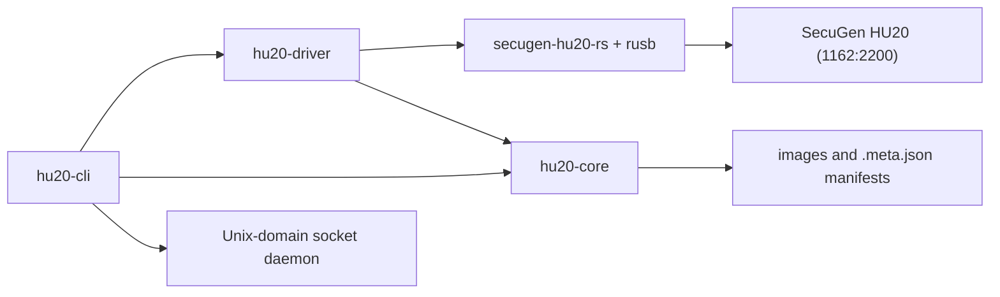

<p align="center">
  
</p>

<h1 align="center">hu20ctl</h1>

<p align="center">
  <strong>Operational CLI, capture daemon, and biometric toolkit for the SecuGen Hamster Pro 20 (HU20) USB fingerprint scanner</strong>
</p>

<p align="center">
  <a href="LICENSE"></a>
  
  
  
</p>

<p align="center">
  <a href="#features">Features</a> ·
  <a href="#quick-start">Quick Start</a> ·
  <a href="#usage">Usage</a> ·
  <a href="#examples">Examples</a> ·
  <a href="#architecture">Architecture</a> ·
  <a href="#security-and-biometric-data">Security</a> ·
  <a href="#documentation">Documentation</a> ·
  <a href="#contributing">Contributing</a>
</p>

---

## What is `hu20ctl`?

`hu20ctl` is an open-source Rust workspace and command-line tool (`hu20ctl`) for acquiring, assessing, enhancing, converting, and matching fingerprints on the **SecuGen Hamster Pro 20 (HU20)** USB optical scanner (`VID 0x1162`, `PID 0x2200`), built on top of [`secugen-hu20-rs`](https://crates.io/crates/secugen-hu20-rs).

## Why `hu20ctl`?

- **Pure-Rust hardware stack:** Communicates directly with the HU20 (`1162:2200`) over USB without proprietary closed-source runtime blobs.
- **Forensic & biometric rigor:** Captures native `300×400` 8-bit grayscale (`120,000` bytes) frames at `500 DPI`, computes quality gates, and writes SHA-256 chain-of-custody `.meta.json` manifests.
- **Hardware-free testability:** Separates pure biometric logic (`hu20-core`) from USB transport (`hu20-driver`), enabling deterministic synthetic testing in CI without a physical scanner.
- **Local service integration:** Includes a Unix-domain socket daemon (`hu20ctl daemon`) for streaming capture events to local desktop or kiosk applications.

## Features

- **Device Discovery & Inspection:** Enumerate and inspect attached SecuGen HU20 (`1162:2200`) scanners with USB bus/address targeting.
- **Smart Capture & Manual Exposure Control:** Hardware Smart Capture auto-exposure is enabled by default and can be disabled with `--no-auto-exposure`; supports `--wait` finger-presence detection.
- **Quality Gate & Enhancement:** Evaluates contrast, variance, ridge clarity, and saturation (`0–100`), with CLAHE + Gabor ridge enhancement.
- **Minutiae & ISO/IEC 19794-2:2011 Templates:** Extracts ridge endings and bifurcations, exports/imports ISO/IEC 19794-2:2011 templates, and performs 1:1 verification and template comparison.
- **8 Image & Biometric Formats:** Exports `png`, `tiff`, `pgm`, `raw`, `bmp`, `jp2`, `wsq`, and `jpeg` with custody manifests.
- **Unix-Domain Socket Daemon:** Streams `waiting_finger`, `finger_detected`, and `completed` JSON events to local clients.

## Use Cases

- Workstation, point-of-sale, and kiosk fingerprint enrollment and verification on Linux and macOS.
- Automated quality assessment and ISO/IEC 19794-2:2011 template generation pipelines.
- Forensic and academic biometric evaluation with reproducible SHA-256 custody manifests.
- Embedded Rust integrations reusing `hu20-core` and `hu20-driver`.

## Requirements

- **Hardware:** SecuGen Hamster Pro 20 (HU20), USB `VID 0x1162`, `PID 0x2200` (`300×400` L8 @ `500 DPI`).
- **Toolchain:** Rust `stable` (`cargo`, `rustc`).
- **OS Permissions:**
  - **Linux:** Install the provided `udev/99-secugen-hu20.rules` rule so non-root users can access the USB device.
  - **macOS:** Uses `rusb` / `libusb` user-space USB access.

## Installation

### macOS with Homebrew

```sh
brew install faeliaso/tap/hu20ctl
```

### Linux release installer

The installer supports `x86_64` and `aarch64`. It downloads the latest GitHub release, verifies its checksum, installs the binary, and configures the SecuGen HU20 udev rules and systemd units. It requires `curl`, `tar`, `sha256sum`, `udevadm`, and administrator privileges.

```sh
curl -fLO https://raw.githubusercontent.com/faeliaso/hu20ctl/main/scripts/install.sh
sudo bash install.sh
```

### Debian / Ubuntu (`.deb`)

Download the `.deb` asset from the [GitHub Releases](https://github.com/faeliaso/hu20ctl/releases) page and install it:

```sh
sudo apt install ./hu20ctl-v<VERSION>-x86_64-unknown-linux-gnu.deb
```

### Build from source

```sh
cargo build --release --workspace
```

The CLI binary is produced at `target/release/hu20ctl`.

To install `hu20ctl` into Cargo's binary directory:

```sh
cargo install --path crates/hu20-cli
```

### Shell autocomplete

Install completion for the shell you use (no scanner or administrator access required):

```sh
hu20ctl completions install zsh
# or: hu20ctl completions install bash
# or: hu20ctl completions install fish
# or: hu20ctl completions install powershell
```

Open a new terminal after installation. The command creates missing user configuration
directories and can be run again safely. See [the manual](docs/MANUAL.md#shell-autocomplete)
for the files and shell startup behavior.

## Quick Start

1. Check connected scanners and system readiness:

```sh
cargo run -p hu20-cli -- devices
cargo run -p hu20-cli -- doctor
```

2. Capture a fingerprint (Smart Capture auto-exposure enabled) into a protected temporary directory:

```sh
cargo run -p hu20-cli -- capture --wait --output /tmp/capture.png
```

3. Assess image quality and extract an ISO/IEC 19794-2:2011 template:

```sh
cargo run -p hu20-cli -- assess /tmp/capture.png
cargo run -p hu20-cli -- template extract /tmp/capture.png --output /tmp/capture.iso2011
```

4. Compare two captures or templates:

```sh
cargo run -p hu20-cli -- verify /tmp/capture1.png /tmp/capture2.png --threshold 40
cargo run -p hu20-cli -- compare /tmp/t1.iso2011 /tmp/t2.iso2011 --threshold 40
```

## Usage

### Common CLI Commands

```sh
# List connected HU20 scanners
hu20ctl devices

# Inspect scanner metadata (optionally target --bus / --address)
hu20ctl device inspect

# Capture with Smart Capture auto-exposure (default) or manual exposure
hu20ctl capture --wait --output /tmp/finger.png
hu20ctl capture --no-auto-exposure --output /tmp/finger_manual.png

# Convert between supported formats (png, tiff, pgm, raw, bmp, jp2, wsq, jpeg)
hu20ctl convert /tmp/finger.png /tmp/finger.wsq --format wsq

# Start the Unix-domain socket daemon (override socket with HU20_SOCKET_PATH)
hu20ctl daemon
```

### Environment Variables

| Variable | Description |
| --- | --- |
| `HU20_MOCK_FIXTURE` | Path to a synthetic PGM/PNG fixture used by the mock USB transport for hardware-free runs. |
| `HU20_SOCKET_PATH` | Override Unix-domain socket path for `hu20ctl daemon`. |

See [docs/MANUAL.md](docs/MANUAL.md) for the complete command reference, manifest schema, and exit codes.

## Examples

Run any of the workspace examples to explore hardware capture, enhancement, templates, custody, daemon IPC, and sensor tuning:

| Example | Crate | Command | Description |
| --- | --- | --- | --- |
| `01_basic_capture` | `hu20-driver` | `cargo run -p hu20-driver --example 01_basic_capture` | Basic USB capture and `.meta.json` generation. |
| `02_quality_and_enhance` | `hu20-core` | `cargo run -p hu20-core --example 02_quality_and_enhance` | Quality scoring, CLAHE, and Gabor ridge enhancement. |
| `03_minutiae_and_templates` | `hu20-core` | `cargo run -p hu20-core --example 03_minutiae_and_templates` | Minutiae extraction and ISO/IEC 19794-2:2011 encoding. |
| `04_verify_and_compare` | `hu20-core` | `cargo run -p hu20-core --example 04_verify_and_compare` | 1:1 fingerprint verification and similarity scoring. |
| `05_wait_and_scenarios` | `hu20-driver` | `cargo run -p hu20-driver --example 05_wait_and_scenarios` | Finger-wait loop and multi-scenario capture flow. |
| `06_custody_and_formats` | `hu20-core` | `cargo run -p hu20-core --example 06_custody_and_formats` | Chain-of-custody verification across all 8 formats. |
| `07_daemon_ipc` | `hu20-cli` | `cargo run -p hu20-cli --example 07_daemon_ipc` | Unix-domain socket IPC client streaming capture events. |
| `08_sensor_tuning` | `hu20-driver` | `cargo run -p hu20-driver --example 08_sensor_tuning` | Manual exposure/gain tuning vs. Smart Capture. |

## Architecture



| Layer | Technology | Responsibility |
| --- | --- | --- |
| CLI | Rust, Clap, Tokio | Command parsing, JSON output, diagnostics, and daemon service. |
| Core | Rust | Image codecs, quality metrics, enhancement, SHA-256 custody manifests, minutiae analysis, and comparison. |
| Driver | `secugen-hu20-rs`, `rusb` | SecuGen HU20 (`1162:2200`) USB discovery, Smart Capture, and mock transport. |
| Operations | udev, systemd | Linux device permissions and optional socket activation. |

## Project Structure

```text
assets/            project icons and visual assets
crates/
  hu20-cli/        command-line interface and capture daemon
  hu20-core/       hardware-independent image and biometric logic
  hu20-driver/     SecuGen HU20 USB-driver integration and mock transport
debian/            Debian packaging metadata
docs/              technical, validation, NFIQ 2, fuzzing, and release guides
fuzz/              cargo-fuzz targets
man/               hu20ctl man page
scripts/           validation and physical-test scripts
systemd/           optional Linux capture-daemon units
tests/             hardware-free tests and approved synthetic fixtures
udev/              Linux USB permission rules
```

## Security and Biometric Data

- Capture only with the operator's explicit command and appropriate authorization.
- Keep real biometric images and generated manifests out of the repository.
- Store sensitive captures only in restricted locations and dispose of them after their technical purpose is complete.
- Report vulnerabilities privately; do not disclose potential data leaks in public issues.

See [SECURITY.md](SECURITY.md) for the operational boundaries, biometric-data lifecycle, and responsible disclosure policy.

## Development

| Command | Description |
| --- | --- |
| `cargo check --workspace` | Type-check the workspace. |
| `cargo test --workspace --verbose` | Run the hardware-free synthetic test suite. |
| `cargo fmt --all -- --check` | Verify Rust formatting. |
| `cargo clippy --workspace --all-targets -- -D warnings` | Run Clippy with warnings treated as errors. |
| `cargo doc --workspace --no-deps` | Build API documentation. |
| `cargo build --release --workspace` | Build release binaries. |
| `./scripts/check-clean-workspace.sh` | Check for biometric-data leaks in the workspace. |

All automated tests use deterministic synthetic fixtures and do not require a scanner. Physical testing is separate and requires authorization:

```sh
./scripts/test-physical.sh
```

Read [TESTING.md](TESTING.md) before running physical tests. The script writes captures to a temporary directory and those artifacts must be protected and safely deleted.

## Documentation

| Document | Contents |
| --- | --- |
| [docs/MANUAL.md](docs/MANUAL.md) | Command reference, options, formats, manifests, and exit codes. |
| [docs/BIOMETRIC_ENGINE.md](docs/BIOMETRIC_ENGINE.md) | Pure-Rust biometric pipeline, Gabor enhancement, 360° alignment, and ZeroFMR gates. |
| [TESTING.md](TESTING.md) | Hardware-free tests, physical scanner testing, and authorized dataset validation. |
| [docs/NFIQ2_INTEGRATION.md](docs/NFIQ2_INTEGRATION.md) | Integration guide for NIST NFIQ 2. |
| [docs/FORENSIC_BIOMETRIC_VALIDATION.md](docs/FORENSIC_BIOMETRIC_VALIDATION.md) | Procedure for authorized biometric validation. |
| [docs/FUZZING.md](docs/FUZZING.md) | Fuzz-testing setup and commands. |
| [docs/RELEASING.md](docs/RELEASING.md) | Release checklist and packaging guide. |
| [THIRD_PARTY_NOTICES.md](THIRD_PARTY_NOTICES.md) | Third-party component and license notices. |
| [CONTRIBUTING.md](CONTRIBUTING.md) | Contribution rules and engineering standards. |
| [SECURITY.md](SECURITY.md) | Security, privacy, and vulnerability-reporting policy. |

## Persistent user configuration

Run `hu20ctl config init` to create a commented TOML file without overwriting an
existing file. Linux uses `$XDG_CONFIG_HOME/hu20ctl/config.toml` when XDG_CONFIG_HOME
is absolute, otherwise `$HOME/.config/hu20ctl/config.toml`. macOS uses
`$HOME/Library/Application Support/hu20ctl/config.toml`.

Use `--config /absolute/path/config.toml` to select another file or `--no-config`
to ignore user configuration. Explicit CLI arguments override supported environment
variables, which override file values, which override built-in defaults.
`HU20_SOCKET_PATH` remains supported. No per-setting environment variables are added.

`config path` reports the selected path, `config show` displays effective settings
and their origins, and `config validate` checks the selected file. These commands
emit JSON (also with `--json`). Missing default files are optional; explicit files
and `config validate` require a readable file. Invalid files and unknown keys fail
with an operational error. `config path`, `--help` and `--version` remain available
when a configuration file is invalid.

```toml
schema_version = 1
[capture]
timeout_secs = 10
min_quality = 50
[enroll]
samples = 3
timeout_secs = 10
min_quality = 50
[verify]
threshold = 40.0
[forensic]
comparison_threshold = 40.0
[conversion]
wsq_bitrate = 0.75
dpi = 500
[driver]
poll_interval_ms = 150
# [daemon]
# socket_path = "/tmp/hu20.sock"
```

Sections are optional. Durations and counts must be positive; quality and match
thresholds must be in 0..100. Conversion settings apply to `tool convert`, not the
physical sensor resolution. Driver polling settings apply to direct waiting and
the daemon worker. Existing IPC request defaults remain unchanged.

Each process reads configuration once. Restart the daemon after changes. The
service runs as root and does not use the installing user's configuration. To use
`/etc/hu20ctl/config.toml`, create that file and configure a systemd override:

```ini
[Service]
ExecStart=
ExecStart=/usr/bin/hu20ctl --config /etc/hu20ctl/config.toml serve --socket-path /run/hu20/hu20.sock
```

Sensor exposure/gain, algorithm tuning, profiles, automatic reload, and USB
transport timeouts are not configured by this first version.

## Contributing

Contributions are welcome. Keep changes focused, add deterministic tests for new behavior, and run the relevant checks before opening a pull request. Never commit real biometric data, custody manifests, or captures.

See [CONTRIBUTING.md](CONTRIBUTING.md) for the complete contribution process and workspace rules.

## Support

For questions, bug reports, or feature requests, open an issue in the repository. For a vulnerability or suspected biometric-data exposure, follow the private reporting process in [SECURITY.md](SECURITY.md).

## License

Licensed under the [MIT License](LICENSE).

Distributed artifacts also include [third-party notices](THIRD_PARTY_NOTICES.md). See the `libusb` note there before redistributing an artifact that statically links the vendored USB library.